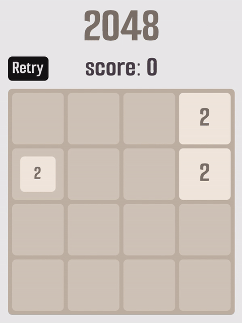

# 2048 Game

This is an implementation of the classic 2048 puzzle game. mainly to explore terra programming language



## Building the Game

the game only use Nanovg and GLFW C libraries

### Prerequisites

To build this project, you will need:
- [Terra](http://terralang.org/)
- A C compiler (build.t use Clang by default)
- archive utility (For Windows use: `llvm-lib`)

### Build Instructions
Execute the build script using Terra:
```
terra build.t
```

### Building for the Web (WebAssembly)

Terra's LLVM backend emits a `wasm32` object file, which is then linked by
[Emscripten](https://emscripten.org/) (it provides libc, GLFW and WebGL 2 as GLES3).

```
source ./emsdk/emsdk_env.sh
terra build.t wasm
```
